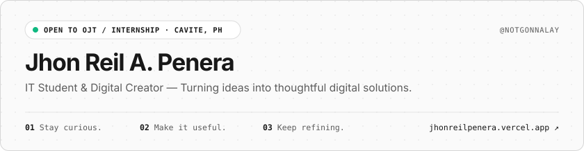
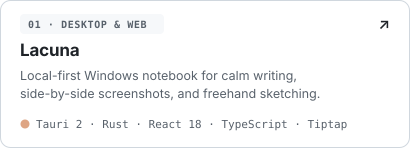
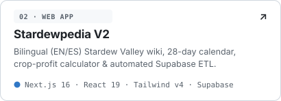
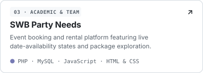
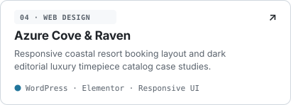

<a href="https://jhonreilpenera.vercel.app/">
  <picture>
    <source media="(prefers-color-scheme: dark)" srcset="./assets/header-dark.svg" />
    <source media="(prefers-color-scheme: light)" srcset="./assets/header-light.svg" />
    
  </picture>
</a>

 

<picture>
  <source
    media="(prefers-color-scheme: dark)"
    srcset="https://readme-typing-svg.demolab.com?font=IBM+Plex+Mono&weight=500&size=15&pause=1800&color=D0D7DE&center=true&vCenter=true&width=640&height=36&lines=Systems+Design+%26+Workflow+Planning;Full-Stack+Web+%26+Desktop+Prototyping;Seeking+Software+%26+Systems+Development+OJT"
  />
  
</picture>

  
  
  
  

---

## About me

- **Studying:** BS Information Technology at **National College of Science & Technology** *(2023–Present)*
- **Working on:** [Lacuna](https://lacuna-silk.vercel.app/) *(local-first Windows desktop notebook)* & [Stardewpedia V2](https://stardewpedia-v2.vercel.app) *(bilingual wiki & farm toolkit)*
- **Learning:** Systems architecture, structured data workflows, and accessible interface polish
- **Open to:** **OJT / internship opportunities** in software and systems development *(Cavite / Metro Manila / Hybrid)*

---

## Tech stack

<picture>
  <source media="(prefers-color-scheme: dark)" srcset="./assets/tech-icons-carousel-dark.svg" />
  <source media="(prefers-color-scheme: light)" srcset="./assets/tech-icons-carousel-light.svg" />
  
</picture>

<strong>View stack breakdown &amp; context</strong>

 

| Area | Tools &amp; Technologies |
| :--- | :--- |
| **Foundations &amp; Databases** | `HTML5` · `CSS3` · `JavaScript` · `PHP` · `MySQL` · `Bootstrap` · `Git & GitHub` |
| **Modern Stacks *(AI-Assisted Builds)*** | `TypeScript` · `React` · `Next.js 16` · `Tailwind CSS v4` · `Supabase` · `Tauri 2` · `Rust` |
| **Design, CMS &amp; QA** | `WordPress` · `Elementor` · `Figma` · `Vercel` · `Playwright` · `Vitest` · `GitHub Actions` |

---

## Featured projects

  <a href="https://lacuna-silk.vercel.app/">
    <picture>
      <source media="(prefers-color-scheme: dark)" srcset="./assets/card-lacuna-dark.svg" />
      
    </picture>
  </a>
  <a href="https://stardewpedia-v2.vercel.app">
    <picture>
      <source media="(prefers-color-scheme: dark)" srcset="./assets/card-stardewpedia-dark.svg" />
      
    </picture>
  </a>
   
  <a href="https://swbpartyneeds.com/">
    <picture>
      <source media="(prefers-color-scheme: dark)" srcset="./assets/card-swb-dark.svg" />
      
    </picture>
  </a>
  <a href="https://jhonreilpenera.vercel.app/projects">
    <picture>
      <source media="(prefers-color-scheme: dark)" srcset="./assets/card-webdesign-dark.svg" />
      
    </picture>
  </a>

 

<strong>Explore full case studies &amp; live project links</strong>

 

- **[Lacuna](https://jhonreilpenera.vercel.app/projects/lacuna)** — Windows 10/11 desktop notepad & web preview ([Live Site ↗](https://lacuna-silk.vercel.app/))
- **[Stardewpedia V2](https://jhonreilpenera.vercel.app/projects/stardewpedia-v2)** — 618-entry bilingual wiki, Valley calendar, profit calculator & Supabase ETL ([Live App ↗](https://stardewpedia-v2.vercel.app))
- **[SWB Party Needs](https://jhonreilpenera.vercel.app/projects/swb-party-needs)** — Event packages & real-time date availability system ([Live Site ↗](https://swbpartyneeds.com/))
- **[Azure Cove](https://jhonreilpenera.vercel.app/projects/azure-cove)** & **[Raven Timepieces](https://jhonreilpenera.vercel.app/projects/raven)** — Responsive WordPress & Elementor web design studies

---

## GitHub activity

<picture>
  <source media="(prefers-color-scheme: dark)" srcset="https://streak-stats.demolab.com?user=notgonnalay&disable_animations=true&border_radius=10&background=111317&border=2D333B&stroke=262B33&ring=F2F4F8&fire=10B981&currStreakLabel=F2F4F8&currStreakNum=F2F4F8&sideNums=F2F4F8&sideLabels=9BA3AF&dates=6E7681" />
  
</picture>

---

## Beyond the repositories

<strong>Experience &amp; highlights</strong>

 

- **Work Immersion — Local Government Office (Anabu II-E Barangay Hall)** · *May 2023*
  - Resident data encoding, digital records organization, administrative helpdesk support, and official document processing.
- **Personal Portfolio Launch** · [jhonreilpenera.vercel.app](https://jhonreilpenera.vercel.app/)
  - Designed and engineered with Next.js 16, TypeScript, Tailwind CSS v4, Vitest, and Playwright.

<strong>Education &amp; seminars</strong>

 

- **Cloud Security &amp; Data Protection: Safeguarding Your Digital Future** — *Seminar · September 19, 2026*
- **National College of Science &amp; Technology** — *BS Information Technology · 2023–Present*
- **Unida Christian School** — *Senior High School (TVL-ICT) · 2021–2023*

---

**Have an OJT opportunity or project in mind? [Let's connect ↗](mailto:jhonrielp@gmail.com)**

© 2026 Jhon Reil A. Penera · Imus, Cavite, Philippines

